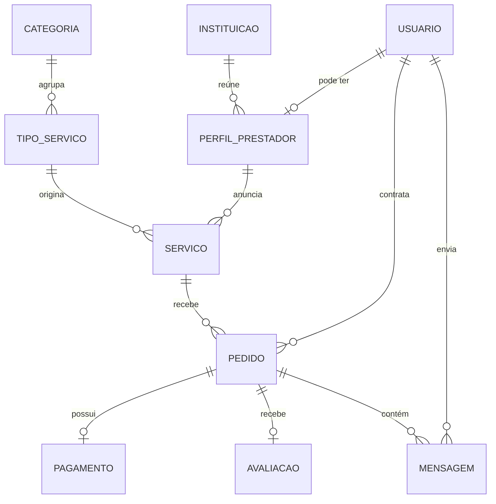

# Talenty – Plataforma de freelas para estudantes

> Projeto final das disciplinas **Aplicações Digitais**, **Prática em Banco de Dados** e **Empreendedorismo** (4º semestre, Ciência da Computação – UNISAGRADO, 2º semestre de 2026).

**Integrantes:** Gabriel Martielo e João Diniz

---

## 1. O problema e a solução

Estudantes universitários querem renda extra e portfólio, mas não sabem onde achar clientes, como precificar o trabalho nem como receber com segurança (medo de calote). Do outro lado, pequenos negócios, autônomos e outros estudantes querem um serviço barato, de um prestador confiável e próximo.

A plataforma conecta os dois lados: **universitários vendem serviços** (sites, design, revisão de texto, monitorias) e **clientes contratam** pela própria plataforma. A empresa ganha uma **comissão de 10% a 15%** por serviço fechado.

Diferenciais implementados no MVP:

- **Perfil como portfólio**, com serviços, nota média e avaliações.
- **Pagamento retido** pela plataforma e liberado só após a entrega (*simulado*, sem dinheiro real).
- **Selo de estudante verificado**, concedido por um administrador.
- **Catálogo de serviços** com preço de referência.
- **Busca por faculdade ou cidade.**
- **Orçamento e chat** dentro de cada pedido.

## 2. Tecnologias

| Camada | Tecnologia |
|---|---|
| Banco de dados | MySQL 8.0.16 ou superior |
| API (back-end) | Python 3.11+ com FastAPI |
| Front-end | React com Vite |
| Autenticação | JWT (token) e hash de senha com bcrypt |
| Documentação da API | Swagger/OpenAPI (gerado pelo FastAPI) |
| Testes | pytest |

## 3. Arquitetura

```
 React (navegador)  ──HTTP/JSON──►  API FastAPI  ──SQL parametrizado──►  MySQL
   só interface                    regras de negócio                      dados
                                   autenticação
```

- O **front-end nunca acessa o banco**: ele só chama a API.
- A **API concentra** as regras de negócio, a autenticação e o acesso ao banco.
- No back-end, o código é dividido em camadas (separação de responsabilidades):
  - `routers/`: recebem as requisições e devolvem as respostas.
  - `services/`: regras de negócio (comissão, fluxo de status, pagamento).
  - `repositories/`: consultas SQL parametrizadas.
  - `schemas/`: validação dos dados de entrada e saída.

### Estrutura de pastas

```
freelas/
├── backend/
│   ├── app/
│   │   ├── main.py            # cria a aplicação e registra as rotas
│   │   ├── config.py          # lê as variáveis do .env
│   │   ├── database.py        # conexão com o MySQL
│   │   ├── security.py        # hash de senha e token JWT
│   │   ├── routers/
│   │   ├── services/
│   │   ├── repositories/
│   │   └── schemas/
│   ├── tests/
│   ├── requirements.txt
│   └── .env.example
├── frontend/
│   ├── src/                   # pages, components, services/api.js, context/AuthContext
│   ├── package.json
│   └── .env.example
├── database/
│   ├── 01_schema_e_dados.sql        # criação das tabelas e dados de exemplo
│   └── 02_consultas_e_dml.sql       # consultas úteis e exemplos de INSERT/UPDATE/DELETE
└── docs/                      # documentação técnica complementar
```

## 4. Banco de dados

### Modelo conceitual e lógico

São **10 tabelas** relacionadas: `instituicao`, `usuario`, `perfil_prestador`, `categoria`, `tipo_servico`, `servico`, `pedido`, `pagamento`, `avaliacao` e `mensagem`.



| Tabela | Função |
|---|---|
| `instituicao` | Faculdades (usadas na busca por faculdade/cidade) |
| `usuario` | Cadastro de qualquer pessoa, com senha em hash e papel (`COMUM` ou `ADMIN`) |
| `perfil_prestador` | Extensão 1:1 do usuário que vende serviços (curso, bio, selo de verificado) |
| `categoria` e `tipo_servico` | Catálogo da plataforma, com preço de referência |
| `servico` | Anúncio criado por um prestador |
| `pedido` | Contratação, com valor, comissão e status |
| `pagamento` | Valor retido/liberado (simulado), 1:1 com o pedido |
| `avaliacao` | Nota de 1 a 5 do cliente, uma por pedido |
| `mensagem` | Chat ligado a um pedido |

Não existe tabela "cliente": **cliente e prestador são papéis do mesmo usuário**, porque um estudante pode vender e contratar.

### Regras de integridade no banco

- Chaves primárias, estrangeiras, `UNIQUE` (e-mail, um pagamento e uma avaliação por pedido).
- `CHECK`: nota entre 1 e 5, comissão entre 10% e 15%, valores positivos e `valor_total = comissão + valor do prestador`.
- *Triggers*: o cliente não pode contratar o próprio serviço, e só se avalia pedido concluído.
- Exclusões protegidas por chave estrangeira (um serviço com pedidos não pode ser apagado).

### Scripts SQL

Estão na pasta `database/`. O script `02_consultas_e_dml.sql` traz 6 consultas úteis e exemplos de INSERT, UPDATE e DELETE com transação (`START TRANSACTION`, `COMMIT` e `ROLLBACK`).

## 5. Regras de negócio

- Fluxo do pedido: `SOLICITADO → ORCADO → ACEITO → PAGO_RETIDO → ENTREGUE → CONCLUIDO` (ou `CANCELADO`).
- O pagamento fica **retido** até o cliente confirmar a entrega. Concluir o pedido e liberar o pagamento acontecem **na mesma transação**.
- A comissão é calculada sobre o valor do pedido, e o valor de cada parte é gravado no pagamento.
- Só os dois envolvidos em um pedido veem o pedido e o chat.
- Só o dono edita ou exclui o próprio serviço.

## 6. Autenticação e autorização

1. **Cadastro:** a senha é transformada em hash (bcrypt) antes de ir ao banco. Nunca é guardada em texto puro.
2. **Login:** a API confere o hash e devolve um **token JWT** com tempo de expiração.
3. **Requisições:** o front envia o token no cabeçalho `Authorization: Bearer <token>`.
4. **Proteção:** as rotas que exigem usuário logado verificam o token. Rotas de administração exigem o papel `ADMIN`.
5. **Controle de acesso:** três níveis (visitante, usuário e admin), além da checagem de "dono do recurso" (serviço, pedido, chat).

### Segurança

- Consultas SQL **parametrizadas** (prevenção de SQL Injection).
- Validação dos dados de entrada na API e tratamento de erros com códigos HTTP adequados (400, 401, 403, 404, 409, 422).
- Segredos e credenciais **somente no `.env`**, que não vai para o repositório. O projeto traz apenas o `.env.example`.
- CORS liberado apenas para o endereço do front-end.

## 7. Integrações externas

No MVP **não há integração obrigatória com serviços externos**. O pagamento é simulado dentro da própria API.

Possível evolução (fora do escopo atual): aviso por WhatsApp quando houver novo orçamento ou mensagem, sempre feito pela nossa API.

## 8. Principais endpoints

A documentação completa e interativa fica no Swagger: **http://localhost:8000/docs**

| Recurso | Endpoints | Acesso |
|---|---|---|
| Autenticação | `POST /auth/cadastro`, `POST /auth/login` | Público |
| Catálogo | `GET /categorias`, `GET /tipos-servico` (admin: `POST`, `PUT`, `DELETE`) | Leitura pública |
| Serviços | `GET /servicos?cidade=&faculdade=&categoria=`, `GET /servicos/{id}`, `POST`, `PUT`, `DELETE` | Leitura pública, escrita do dono |
| Prestadores | `GET /prestadores/{id}`, `POST /prestadores`, `PATCH /prestadores/{id}/verificar` | Verificar: admin |
| Pedidos | `POST /pedidos`, `GET /pedidos`, `GET /pedidos/{id}`, `PATCH /pedidos/{id}/status` | Só os dois envolvidos |
| Pagamento | `POST /pedidos/{id}/pagamento`, `POST /pedidos/{id}/liberar` | Cliente do pedido |
| Avaliações | `POST /pedidos/{id}/avaliacao` | Cliente do pedido |
| Chat | `GET` e `POST /pedidos/{id}/mensagens` | Só os dois envolvidos |

## 9. Testes automatizados

Os testes usam **pytest** e ficam em `backend/tests/`. Cobrem regras de negócio, validações e casos de sucesso e de erro, por exemplo:

- cálculo da comissão e da divisão do pagamento;
- transições de status permitidas e proibidas no pedido;
- cliente tentando contratar o próprio serviço (deve falhar);
- avaliação fora do intervalo de 1 a 5 ou de pedido não concluído (deve falhar);
- cadastro com e-mail repetido e login com senha errada;
- acesso a rota protegida sem token (401) e sem permissão (403).

Para executar:

```bash
cd backend
pytest
```

## 10. Como instalar e executar

### Pré-requisitos

- Python 3.11 ou superior
- Node.js 20 ou superior (com npm)
- MySQL 8.0.16 ou superior (versões anteriores ignoram as restrições `CHECK`)

### Passo 1 – Banco de dados

> O script **apaga e recria** o banco `freelas_estudantes`. Não rode em um banco que você já usa.

```bash
mysql -u root -p < database/01_schema_e_dados.sql
```

(Opcional) Para ver as consultas e os exemplos de DML: `mysql -u root -p < database/02_consultas_e_dml.sql`

### Passo 2 – API (back-end)

```bash
cd backend
python -m venv venv
source venv/bin/activate        # no Windows: venv\Scripts\activate
pip install -r requirements.txt
cp .env.example .env            # no Windows: copy .env.example .env
```

Abra o `.env` e preencha com os dados do seu MySQL e uma chave secreta própria:

| Variável | Para que serve |
|---|---|
| `DB_HOST`, `DB_PORT` | Endereço do MySQL (normalmente `localhost` e `3306`) |
| `DB_USER`, `DB_PASSWORD` | Usuário e senha do MySQL |
| `DB_NAME` | Nome do banco (`freelas_estudantes`) |
| `JWT_SECRET` | Chave secreta para assinar os tokens (use um valor longo e aleatório) |
| `JWT_ALGORITHM` | Algoritmo do token (`HS256`) |
| `JWT_EXPIRE_MINUTES` | Tempo de validade do token |
| `CORS_ORIGINS` | Endereço do front (`http://localhost:5173`) |

Inicie a API:

```bash
uvicorn app.main:app --reload
```

A API fica em `http://localhost:8000` e o Swagger em `http://localhost:8000/docs`.

### Passo 3 – Front-end

```bash
cd frontend
npm install
cp .env.example .env            # no Windows: copy .env.example .env
npm run dev
```

No `.env` do front, defina `VITE_API_URL=http://localhost:8000`. A interface abre em `http://localhost:5173`.

### Primeiro acesso

Os usuários do script de exemplo têm hashes de senha **fictícios** e não permitem login. Crie uma conta pela tela de **Cadastro**. Para testar as telas de administração, altere o papel do usuário no banco:

```sql
UPDATE usuario SET papel = 'ADMIN' WHERE email = 'seu-email@exemplo.com';
```

## 11. Status do projeto

- [x] Modelagem do banco e scripts SQL (testados)
- [ ] API: autenticação (cadastro e login)
- [ ] API: catálogo, serviços e pedidos
- [ ] API: pagamento simulado, avaliação e verificação
- [ ] API: chat
- [ ] Front-end: telas públicas, cadastro e login
- [ ] Front-end: pedidos, serviços e perfil
- [ ] Testes automatizados
- [ ] Revisão final da documentação

## 12. Declaração de uso de Inteligência Artificial

> Rascunho com o que já aconteceu. **O grupo deve revisar e completar ao final do projeto**, com as suas próprias experiências.

**Ferramentas e modelos:** Claude (Anthropic), pelo claude.ai. Modelo: [conferir o nome exato do modelo na interface].

**Atividades em que a IA foi usada:**

- Brainstorming de ideias de projeto e escolha do escopo do MVP.
- Leitura e comparação dos requisitos das duas disciplinas.
- Proposta do modelo conceitual e lógico do banco.
- Geração dos scripts SQL (criação, dados de exemplo, consultas e DML).
- Proposta da lista de telas, da estrutura de pastas e do cronograma.
- Redação deste README.
- [Acrescentar: código da API, do front, dos testes e da documentação, conforme for acontecendo.]

**Erros ou limitações identificados nas respostas:**

- A IA citou inicialmente que o prazo do banco vinha antes, mas o prazo de Aplicações Digitais (15/11) é anterior ao de Banco de Dados (01/12). Foi corrigido pelo grupo.
- Os scripts SQL foram testados em **MariaDB 10.11** (compatível com MySQL 8), e não no MySQL em si. O grupo precisa conferir a execução no MySQL.
- Os dados de exemplo usam hashes de senha fictícios, então não servem para login real.
- [Acrescentar outros erros encontrados durante o desenvolvimento.]

<!-- **Correções e adaptações feitas pelo grupo:**

- [Preencher: o que foi alterado, rejeitado ou reescrito em relação ao que a IA sugeriu.] -->

<!-- **Principais dificuldades:**

- [Preencher.] -->

<!-- **Avaliação de como a IA contribuiu:**

- [Preencher no final. Inclua o que acelerou, o que atrapalhou e o que o grupo precisou estudar para entender.]

O grupo é responsável por todo o conteúdo entregue, e todos os integrantes sabem explicar o código, inclusive as partes feitas com apoio de IA. -->

<!-- ## 13. Equipe

| Integrante | Responsabilidades principais |
|---|---|
| [Nome 1] | [ex.: banco de dados e API] |
| [Nome 2] | [ex.: front-end e testes] | -->

Todas as partes foram revisadas por ambos os integrantes.